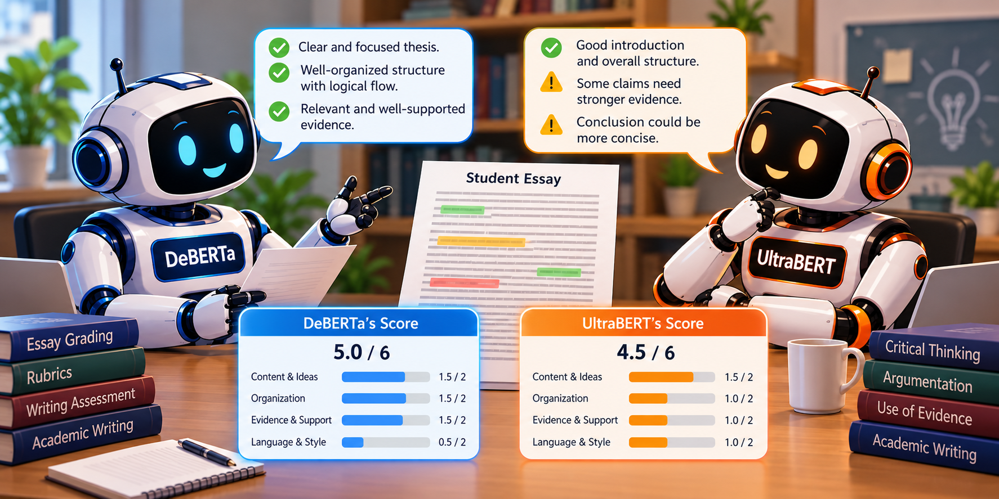

```{r setup, include=FALSE}
knitr::opts_chunk$set(echo = TRUE, eval = TRUE, warning = FALSE, message = FALSE)
suppressWarnings({
  # Add all the packages you will use in the article here
  library("rmarkdown")
  library("kableExtra")
  library("dplyr")
  library("tidyr")
  library("ggplot2")
  library("ggrepel")
})

# One fixed color per model, used in every figure
model_colors <- c("DeBERTa-v3-base (512)" = "#eb6834",
                  "UltraBERT-150M (512)"  = "#1baf7a",
                  "UltraBERT-150M (2048)" = "#2a78d6")

theme_blog <- theme_minimal(base_size = 13) +
  theme(panel.grid.minor = element_blank(),
        panel.grid.major = element_line(color = "grey90"),
        strip.text = element_text(face = "bold", size = 12),
        legend.position = "bottom")
```



## Introduction

I recently started a new automated essay scoring (AES) project using thousands of argumentative essays written by middle and high school students. As usual, my first step was to fine-tune a transformer encoder on the essays and see how well its scores agreed with human raters. The model did a good job overall, but its predictions for the top-scoring essays were often a point too low. When I looked at those essays more closely, I noticed something they had in common: they were long. Their writers had developed their arguments over several paragraphs, added counterarguments, and closed with a careful conclusion. Then I checked the model configuration and found a likely reason. The model never saw most of those conclusions. It only read the first 512 tokens of each essay and threw the rest away.

This is not a bug in a particular model. It is a design limit shared by most of the transformer encoders that the AES community has relied on, such as BERT, RoBERTa, and DeBERTa. These models can only process a fixed number of tokens at once, and for most of them that number is 512. When an essay is longer than that, we have to cut it (i.e., truncate it), and whatever comes after the cut is invisible to the model.

Recently, a new family of encoders called **UltraBERT** was released with a native context window of 32,000 tokens [@park2026ultrabert]. That is long enough to read almost any student essay in full. So, a natural question is: *If we let the model read the whole essay, do we get better scores?* In this post, I try to answer this question using the PERSUADE 2.0 corpus [@crossley2024persuade]. I compare DeBERTa-v3 [@he2023debertav3], which has been a popular choice in recent essay scoring competitions on Kaggle, to UltraBERT. I also run a small experiment that separates two things that usually get mixed together: the benefit of a *better model* and the benefit of a *longer context window*.

Before we begin, I want to note that these are initial findings from an ongoing project. I will be clear about what the results do and do not show at the end of the post.

## Encoders, Tokens, and Context Windows

Let's start with a few terms that we will use throughout the post.

* **Encoder**: A transformer model that reads a piece of text and turns it into a set of numerical vectors (i.e., embeddings). For essay scoring, we put a small prediction layer on top of the encoder and *fine-tune* the whole thing, so that the embeddings learn to capture the features of writing quality that human raters care about.
* **Token**: The unit of text that a model actually reads. Tokens are usually words or pieces of words. For example, a tokenizer might split "unbelievable" into "un", "believ", and "able". In the data set used in this post, the median essay has 375 words and about 430 tokens.
* **Context window**: The maximum number of tokens an encoder can read at once. For DeBERTa-v3, it is 512 tokens. For UltraBERT, it is 32,768 tokens.
* **Truncation**: Cutting the text at the context window limit. The common default is "head" truncation, which keeps the first 512 tokens and drops the rest.

Why do most encoders stop at 512 tokens? In a standard transformer, every token "attends" to every other token, so the amount of computation grows with the *square* of the text length. Doubling the length quadruples the cost. UltraBERT gets around this with a mixed design: two out of every three layers use *local* attention (each token only looks at 128 tokens on either side), and every third layer uses *global* attention over the entire text. This keeps the computation manageable while still letting information flow across the whole document.

The two models we compare in this post are as follows:

* **DeBERTa-v3-base** [@he2023debertav3]: 184 million parameters, 512-token context window. DeBERTa-v3 is known for its *disentangled attention*, which represents the content and the position of each word separately. It has been one of the strongest encoders for text classification tasks, including essay scoring.
* **UltraBERT-150M** [@park2026ultrabert]: 152 million parameters, 32,768-token context window. It is a newer encoder trained on a large mix of web, educational, scientific, and code data. Its model card recommends noticeably lower learning rates for fine-tuning than other encoders, which we will follow.

## Scoring Essays as an Ordinal Problem

Holistic essay scores (e.g., 1 to 6) are neither simple categories nor continuous numbers. They are *ordinal*: a 5 is better than a 4, but the difference between 4 and 5 is not necessarily the same as between 1 and 2. If we treat the scores as unordered categories, the model does not know that predicting a 5 for a 6-point essay is a smaller mistake than predicting a 1. If we treat them as continuous numbers, we impose an equal spacing that may not exist.

In this post, I use the **CORN** approach (Conditional Ordinal Regression for Neural networks) [@shi2023corn]. The idea is simple. Instead of predicting the score directly, the model answers a series of yes/no questions:

* Is the score higher than 1?
* *If yes*, is the score higher than 2?
* *If yes*, is the score higher than 3?
* ... and so on, up to "Is the score higher than 5?"

Each question is learned only from the essays for which the previous answer was "yes". Multiplying the conditional probabilities gives us the probability that the score exceeds each level, and from those we get a full probability distribution over the six scores. The final predicted score is the number of "yes" answers.

To evaluate the models, I use **quadratic weighted kappa (QWK)** [@cohen1968weighted], the standard agreement statistic in AES. QWK compares model scores to human scores and penalizes disagreements by the *square* of their size. So, missing by two points costs four times as much as missing by one point. A QWK of 1 means perfect agreement, and 0 means agreement no better than chance. I also report *exact agreement* (the percentage of essays where the model and human scores are identical) and *adjacent agreement* (the percentage within one point).

## Example

### Data

For this example, I use the [PERSUADE 2.0 corpus](https://github.com/scrosseye/persuade_corpus_2.0) [@crossley2024persuade]. It includes about 26,000 argumentative essays written by students in grades 6 to 12 in response to 15 different prompts. Each essay received a holistic score from 1 to 6. The scores were assigned by two trained raters using an SAT-style rubric, and every disagreement was resolved by a third rater. Before adjudication, the two raters agreed with a weighted kappa of .745.

The data files are too large for GitHub, so they are shared through the links in the [PERSUADE 2.0 README](https://github.com/scrosseye/persuade_corpus_2.0). There are two files: `persuade_corpus_2.0_train.csv` and `persuade_corpus_2.0_test.csv`. The test file comes as a password-protected zip file, and the password is given in the README. Please note that the corpus is shared under the [CC BY-NC-SA 4.0](https://creativecommons.org/licenses/by-nc-sa/4.0/) license, so it can be used for non-commercial purposes only.

### Reading and Preparing the Data

In this section, I will show how to read the two files into Python and prepare them for essay scoring. All the steps are also available as a single script, [prepare_persuade.py](code/prepare_persuade.py). After downloading the data, you can put the two files in the same folder as the script and run `python prepare_persuade.py`. The script saves a clean file with one row per essay.

The first thing to know about the PERSUADE 2.0 files is that they are organized by *discourse element*, not by essay. Each row is one part of an essay (e.g., a lead, a position, a claim, or a piece of evidence), and the essay-level information, such as the full text, the holistic score, the prompt, and the student's demographics, is repeated on every row of the same essay. Since we score whole essays, we need to read both files, stack them, and keep only one row per essay. These are the columns we need:

* **essay_id_comp**: A unique identifier for each essay
* **full_text**: The full text of the essay
* **holistic_essay_score**: The holistic score from 1 to 6
* **prompt_name**: The name of the writing prompt (15 prompts)
* **task**: Independent or text-dependent (i.e., source-based) writing
* **ell_status**: Whether the student is an English language learner

```{python read-data, eval=FALSE, python.reticulate=FALSE}
import hashlib
import re
import numpy as np
import pandas as pd

# Read the two files and stack them
files = ["persuade_corpus_2.0_train.csv", "persuade_corpus_2.0_test.csv"]
rows = pd.concat([pd.read_csv(f, low_memory=False) for f in files], ignore_index=True)
print(rows.shape)

# Keep one row per essay and give the columns shorter names
essays = (rows[["essay_id_comp", "full_text", "holistic_essay_score",
                "prompt_name", "task", "ell_status"]]
          .drop_duplicates("essay_id_comp")
          .rename(columns={"essay_id_comp": "essay_id",
                           "full_text": "text",
                           "holistic_essay_score": "score"})
          .reset_index(drop=True))
print(essays.shape)
```

```
(285383, 27)
(25996, 6)
```

The output shows that the two files contain 285,383 discourse elements from 25,996 essays. Before we move on, there are three small problems in the data that we need to fix. They are easy to miss, but each of them can cause trouble later.

1. **Damaged IDs**: The IDs are supposed to be 12-character codes such as "423A1CA112E2". For 112 essays, however, the IDs look like "4.45649E+11". This happens when a file is opened in spreadsheet software, which reads some IDs as numbers in scientific notation and rounds them. The original IDs cannot be recovered from these files, so I replace them with a new ID created from the essay text itself. The same text always produces the same ID, so the replacement is stable across runs.
2. **Duplicate essays**: Two essays appear twice under different IDs. If one copy ends up in the training set and the other in the test set, the model would be tested on an essay it has already seen. So, I keep only the first copy. To catch copies that differ only in spacing or capitalization, I compare the texts after collapsing white space and converting them to lower case.
3. **Blank values**: In the ELL status column, 92 values contain a single space instead of being empty. I convert them to missing values, so they are not counted as a separate group in the subgroup analyses.

```{python clean-data, eval=FALSE, python.reticulate=FALSE}
# Problem 1: IDs damaged by spreadsheet software (e.g., "4.45649E+11")
valid = essays["essay_id"].str.fullmatch(r"[0-9A-F]{12}")
print("Damaged IDs:", (~valid).sum())

def text_id(text):
    """A stable ID made from the essay text itself."""
    key = re.sub(r"\s+", " ", text).strip().lower()
    return "X" + hashlib.sha1(key.encode()).hexdigest()[:11].upper()

essays.loc[~valid, "essay_id"] = essays.loc[~valid, "text"].map(text_id)

# Problem 2: the same essay text appearing under two IDs
key = essays["text"].str.replace(r"\s+", " ", regex=True).str.strip().str.lower()
print("Duplicate texts:", key.duplicated().sum())
essays = essays[~key.duplicated()].reset_index(drop=True)

# Problem 3: blank strings that actually mean "missing"
essays["ell_status"] = essays["ell_status"].str.strip().replace("", np.nan)

print(essays.shape)
print(essays["score"].value_counts().sort_index())
```

```
Damaged IDs: 112
Duplicate texts: 2
(25994, 6)
score
1    1028
2    5699
3    8368
4    6730
5    3296
6     873
Name: count, dtype: int64
```

After cleaning, we have 25,994 essays. The score distribution shows that most essays received a 2, 3, or 4, while scores of 1 and 6 are relatively rare. This is typical for holistic essay scores, and it is one of the reasons why exact agreement with human raters is harder to achieve at the two ends of the scale.

The last step is to split the essays into training (70%), development (10%), and test (20%) sets. The training set is used to fine-tune the models, the development set is used to choose the best checkpoint during training and to calibrate the models, and the test set is used only once, for the final evaluation. I *stratify* the split by prompt and score. That is, within each combination of prompt and score (e.g., essays scored 4 for "Exploring Venus"), I shuffle the essays and cut them into the three sets. This way, each set has the same mix of prompts and score levels.

```{python split-data, eval=FALSE, python.reticulate=FALSE}
def stratified_split(df, dev_frac=0.1, test_frac=0.2, seed=42):
    """Shuffle each prompt x score cell and cut it into test, dev, and train."""
    rng = np.random.default_rng(seed)
    split = pd.Series("train", index=df.index)
    for _, cell in df.groupby(["prompt_name", "score"]):
        idx = rng.permutation(cell.index.to_numpy())
        n_test = round(len(idx) * test_frac)
        n_dev = round(len(idx) * dev_frac)
        split[idx[:n_test]] = "test"
        split[idx[n_test:n_test + n_dev]] = "dev"
    return split

essays["split"] = stratified_split(essays)
print(essays["split"].value_counts())
```

```
split
train    18197
test      5199
dev       2598
Name: count, dtype: int64
```

All three models below use the exact same split, and all the numbers I report come from the 5,199 essays in the test set, which none of the models saw during training. If you run the script yourself, you will get sets of the same size, but not necessarily the same essays in each set, because my project code shuffles the essays in a slightly different order. So, your results may differ a little from the ones reported here.

### How Long Are the Essays?

Before training anything, let's see how big the truncation problem is. The code below shows how I counted the tokens in each essay. Note that the two models use different tokenizers, so the same essay can have a slightly different number of tokens for each model.

```{python token-count, eval=FALSE, python.reticulate=FALSE}
from transformers import AutoTokenizer

tokenizer = AutoTokenizer.from_pretrained("microsoft/deberta-v3-base")

# Tokenize without special tokens and without truncation
token_ids = tokenizer(essays["text"].tolist(),
                      add_special_tokens=False,
                      truncation=False)["input_ids"]
essays["n_tokens"] = [len(ids) for ids in token_ids]

# DeBERTa reserves two positions for its special tokens ([CLS] and [SEP])
budget = 512 - 2
print((essays["n_tokens"] > budget).mean())
```

With the DeBERTa tokenizer, **36% of the essays are longer than 512 tokens**. That is already a lot. But the more interesting part is *which* essays are long. The following figure shows the percentage of essays that exceed the limit at each score level.

```{r fig-truncation, echo=TRUE, eval=TRUE, layout="l-body-outset", fig.width=8, fig.height=4.5, fig.cap="Percentage of essays longer than 512 tokens (DeBERTa tokenizer) by human score"}
trunc <- read.csv("data/truncation_by_score.csv") %>%
  filter(tokenizer == "DeBERTa-v3-base", score != "all")

ggplot(trunc, aes(x = factor(score), y = share_over_512)) +
  geom_col(fill = "#2a78d6", width = 0.6) +
  geom_text(aes(label = scales::percent(share_over_512, accuracy = 1)),
            vjust = -0.5, size = 4.2) +
  scale_y_continuous(labels = scales::percent, limits = c(0, 1.08)) +
  labs(x = "Human score", y = "Essays longer than 512 tokens") +
  theme_blog
```

The figure shows that truncation is not random at all. Only about 5% to 15% of the essays scored 1, 2, or 3 are cut. In contrast, 95% of the essays scored 5 and almost every essay scored 6 are cut. In other words, a 512-token model reads the weakest essays in full, but it never sees the end of the strongest essays. This is exactly where writers tend to place their counterarguments, rebuttals, and conclusions.

With the UltraBERT tokenizer, the median essay has 444 tokens, 95% of the essays have fewer than 908 tokens, and the longest essay has 2,126 tokens. So, I set UltraBERT's maximum length to 2,048 tokens. At this length, only **one** essay out of 25,994 is truncated.

### Fine-Tuning the Encoders

Next, I fine-tuned three models. The first two are the obvious comparison: DeBERTa-v3-base at 512 tokens and UltraBERT-150M at 2,048 tokens. The third one is the key to this post: **UltraBERT-150M restricted to 512 tokens**. This third model has UltraBERT's architecture and pre-training, but it reads exactly as much text as DeBERTa. This allows us to split the overall difference into two parts:

* **Architecture effect**: UltraBERT (512) vs. DeBERTa (512). Same amount of text, different model.
* **Context effect**: UltraBERT (2048) vs. UltraBERT (512). Same model, more text.

This type of design is often called an *ablation*: we remove one ingredient at a time to see how much each one contributes. The code below shows the core of the model. An encoder produces a vector for each token, I average these vectors into a single essay vector (i.e., mean pooling), and a CORN layer with five outputs turns it into the yes/no answers described above.

```{python model, eval=FALSE, python.reticulate=FALSE}
import torch
from torch import nn
import torch.nn.functional as F
from transformers import AutoModel

class EncoderCORN(nn.Module):
    def __init__(self, model_name, num_classes=6, dropout=0.1):
        super().__init__()
        # Load the weights in float32 (more on this below)
        self.encoder = AutoModel.from_pretrained(model_name, dtype=torch.float32)
        self.dropout = nn.Dropout(dropout)
        # One output per question: "Is the score higher than k?"
        self.head = nn.Linear(self.encoder.config.hidden_size, num_classes - 1)

    def forward(self, input_ids, attention_mask):
        hidden = self.encoder(input_ids=input_ids,
                              attention_mask=attention_mask).last_hidden_state
        # Mean pooling: average the token vectors, ignoring padding
        mask = attention_mask.unsqueeze(-1).float()
        pooled = (hidden * mask).sum(1) / mask.sum(1)
        return self.head(self.dropout(pooled))

def corn_loss(logits, y):
    """Question k is trained only on essays with y >= k (y = score - 1)."""
    total, count = 0.0, 0
    for k in range(logits.shape[1]):
        keep = y >= k
        target = (y[keep] > k).float()
        total += F.binary_cross_entropy_with_logits(logits[keep, k], target, reduction="sum")
        count += int(keep.sum())
    return total / count
```

All models were trained for four epochs with the AdamW optimizer, an effective batch size of 16 essays, and a linear learning rate schedule with warm-up. Following its model card, UltraBERT used a lower learning rate (1e-5 vs. 2e-5 for DeBERTa) and slightly different optimizer settings. Every 500 steps, I evaluated the model on the development set and kept the checkpoint with the highest QWK. I trained all the models on a single Apple Silicon computer, which is a nice reminder of how far these tools have come.

<aside>
A practical tip: recent versions of the **transformers** library load model weights in the data type they were saved in. DeBERTa-v3 is saved in half precision (float16), which caused my training to crash on Apple's GPU. Passing `dtype=torch.float32` when loading the model fixed it.
</aside>

The following figure shows how the QWK on the development set changed during training.

```{r fig-curves, echo=TRUE, eval=TRUE, layout="l-body-outset", fig.width=8, fig.height=5, fig.cap="Development-set QWK during training"}
curves <- read.csv("data/training_curves.csv")
last_points <- curves %>% group_by(model) %>% filter(step == max(step))

ggplot(curves, aes(x = step, y = dev_qwk, color = model)) +
  geom_line(linewidth = 1) +
  geom_point(size = 2.5) +
  geom_text_repel(data = last_points, aes(label = model), size = 3.8,
                  nudge_x = 250, hjust = 0, direction = "y",
                  segment.color = NA, show.legend = FALSE) +
  scale_color_manual(values = model_colors) +
  scale_x_continuous(limits = c(0, 6300), breaks = seq(0, 4500, 1500)) +
  labs(x = "Training step", y = "Development QWK", color = NULL) +
  theme_blog +
  theme(legend.position = "none")
```

Two patterns stand out. First, both UltraBERT models learn faster than DeBERTa. After only 1,500 steps, the full-context UltraBERT model already reaches a development QWK of .874, which is higher than DeBERTa's best value (.865) at the end of training. Second, the two UltraBERT models behave differently in the second half of training. The 512-token version peaks at step 2,000 and then slowly declines, while the 2,048-token version keeps improving until step 3,500. When the model can only see the beginning of long essays, it seems to run out of useful information sooner and starts to overfit.

### Results

Now let's look at the results on the test set. The table below summarizes the three models. For the calibration column, I first applied *temperature scaling* [@guo2017calibration], a simple method that adjusts the model's confidence using the development set. I will come back to calibration later.

```{r tab-summary, echo=TRUE, eval=TRUE}
summary_tab <- read.csv("data/model_summary.csv") %>%
  transmute(Model = model,
            `Max tokens` = max_tokens,
            `Truncated` = scales::percent(share_truncated, accuracy = 0.1),
            QWK = round(qwk, 3),
            `QWK (mean of prompts)` = round(qwk_prompt_avg, 3),
            `Exact` = scales::percent(exact, accuracy = 0.1),
            `Adjacent` = scales::percent(adjacent, accuracy = 0.1))

kable(summary_tab, caption = "Test-set results (5,199 essays)") %>%
  kable_styling(bootstrap_options = c("striped", "hover"), full_width = TRUE)
```

UltraBERT at 2,048 tokens is the best model on every measure: QWK increases from .861 to .882, the average QWK across the 15 prompts increases from .806 to .831, and exact agreement increases from 67.2% to 71.0%. These numbers are also well above the .745 agreement between two human raters. However, this is not a fair comparison, because the model is compared to the *adjudicated* score while the human value compares two individual raters.

A difference of .021 in QWK may not sound like much. Is it real, or could it be due to the particular essays in the test set? To answer this question, I used a **paired bootstrap**. I resampled the 5,199 test essays with replacement 2,000 times, computed the QWK difference between the two models on each resample, and took the middle 95% of these differences as a confidence interval. "Paired" means both models are always evaluated on the same resampled essays, which removes the noise that comes from essays being harder or easier.

```{r tab-decomp, echo=TRUE, eval=TRUE}
decomp <- read.csv("data/decomposition.csv") %>%
  filter(!grepl("^QWK", comparison)) %>%
  mutate(Gain = sprintf("%+.3f [%+.3f, %+.3f]", qwk_gain, ci_low, ci_high),
         Subset = sprintf("%s (n = %s)", subset, format(n, big.mark = ","))) %>%
  select(Subset, comparison, Gain) %>%
  pivot_wider(names_from = comparison, values_from = Gain)

kable(decomp, caption = "QWK gains with 95% bootstrap confidence intervals") %>%
  kable_styling(bootstrap_options = c("striped", "hover"), full_width = TRUE)
```

This table is the heart of the post, so let's read it row by row.

* **All test essays**: Of the total gain of .021, about two-thirds (+.013) comes from the architecture and about one-third (+.007) comes from the longer context window. Both confidence intervals exclude zero, so both effects are unlikely to be due to chance. Still, the context effect is the smaller and less certain of the two.
* **Essays longer than 512 tokens**: Here the picture changes. Reading the full essay improves QWK by +.045, which is *larger* than the architecture effect (+.031). For these essays, QWK goes from .735 (DeBERTa) to .766 (UltraBERT at 512) to .811 (UltraBERT at 2,048).
* **Essays of 512 tokens or shorter**: The context effect is essentially zero (+.001), which is exactly what we should expect. If the essay already fits into 512 tokens, a longer window cannot show the model anything new. This row works as a built-in sanity check for the experiment.

The same pattern appears at the prompt level. Some prompts naturally produce longer essays than others. For example, only 11% of the test essays written for "Cell phones at school" are longer than 512 tokens, compared to 76% for "Summer projects". If the context window matters, the gain from UltraBERT should be larger for prompts with more long essays.

```{r fig-prompts, echo=TRUE, eval=TRUE, layout="l-body-outset", fig.width=9, fig.height=6, fig.cap="QWK gain of UltraBERT (2048) over DeBERTa (512) by prompt"}
prompts <- read.csv("data/per_prompt_qwk.csv") %>%
  select(prompt, model, qwk, share_long) %>%
  pivot_wider(names_from = model, values_from = qwk) %>%
  mutate(gain = `UltraBERT-150M (2048)` - `DeBERTa-v3-base (512)`)

ggplot(prompts, aes(x = share_long, y = gain)) +
  geom_hline(yintercept = 0, color = "grey60") +
  geom_smooth(method = "lm", se = FALSE, color = "grey70", linewidth = 0.8) +
  geom_point(size = 3, color = "#2a78d6") +
  geom_text_repel(aes(label = prompt), size = 3.3, color = "grey20",
                  min.segment.length = 0.3, segment.color = "grey70", seed = 1) +
  scale_x_continuous(labels = scales::percent, expand = expansion(mult = 0.12)) +
  labs(x = "Share of test essays longer than 512 tokens",
       y = "QWK gain (UltraBERT 2048 - DeBERTa 512)") +
  theme_blog
```

The correlation between the share of long essays and the QWK gain across the 15 prompts is about .54. Prompts like "Distance learning", "Seeking multiple opinions", and "Mandatory extracurricular activities", where more than half of the essays are long, show gains of around .05. Most prompts with few long essays show little or no gain. With only 15 prompts, this is a rough pattern rather than a precise estimate, and there are exceptions: "The Face on Mars" gains .057 even though only 26% of its essays are long, while "Grades for extracurricular activities" gets slightly *worse*. Still, the overall direction agrees with the table above.

### Does Reading More Remove the Length Bias?

So far, the story seems simple: let the model read the whole essay, and it will score long essays better. But there is a catch, and it is an important one for anyone who uses AES in practice. AES models are known to reward length, partly because longer essays tend to receive higher scores from human raters, too. A model can learn "long means good" as a shortcut without learning *why* long essays are often better.

To check this, I compared the average error (model score minus human score) for short and long essays *at the same human score*. If a model scores essays based on their quality, the error should not depend on length once we hold the human score constant.

```{r fig-bias, echo=TRUE, eval=TRUE, layout="l-page", fig.width=11, fig.height=4.5, fig.cap="Average error (model - human) by human score and essay length"}
bias <- read.csv("data/error_by_score_length.csv") %>%
  filter(n >= 20) %>%   # drop cells with very few essays
  mutate(model = factor(model, levels = names(model_colors)))

ggplot(bias, aes(x = factor(score), y = mean_error, color = length, group = length)) +
  geom_hline(yintercept = 0, color = "grey60") +
  geom_line(linewidth = 1) +
  geom_point(size = 2.8) +
  facet_wrap(~ model) +
  scale_color_manual(values = c("512 tokens or shorter" = "grey55",
                                "Longer than 512 tokens" = "#6250d6")) +
  labs(x = "Human score", y = "Average error (model - human)", color = NULL) +
  theme_blog
```

The figure shows that **all three models still reward length**. For example, among essays that human raters scored 2, DeBERTa over-scores long essays by 0.87 points on average but short essays by only 0.23 points. The full-context UltraBERT model reduces this gap (0.66 vs. 0.15), but it does not close it. Among essays scored 5, short essays are *under*-scored by 0.8 to 1.0 points by every model. So, the longer context window makes the scores more accurate, but it does not teach the model to stop using length as a signal. In fact, among the essays scored 4, the correlation between essay length and the predicted score is about .42 to .44 for all three models.

This finding matters because length is easy to game. A student (or a chatbot) can add sentences without adding substance. I will test this directly in a future post by padding essays with irrelevant text and measuring how much the scores inflate.

### Calibration and Fairness

Two more results are worth mentioning briefly.

* **Calibration**: A model is *well calibrated* when its confidence matches its accuracy. For example, among the essays where it is 80% confident, it should be right about 80% of the time. Before temperature scaling, all three models were overconfident, and UltraBERT at 2,048 tokens was the most overconfident one (expected calibration error = .18). After temperature scaling, all three models were well calibrated (expected calibration error between .015 and .028). The lesson: never use the raw probabilities of a fine-tuned encoder for decisions such as sending uncertain essays to human raters. Calibrate them first.
* **Subgroup differences**: Following @williamson2012framework, I computed the standardized mean difference (SMD) between model and human scores for students identified as English language learners (ELL) and non-ELL students. For all three models, the SMDs were small (between -.07 and .09), well below the .10 threshold that is commonly used to flag subgroup differences.

## Concluding Remarks

In this post, I compared DeBERTa-v3 and UltraBERT for automated essay scoring using the PERSUADE 2.0 corpus. Here are the main takeaways:

1. **Truncation is not neutral.** At 512 tokens, about a third of the essays are cut, but almost all of them are high-scoring essays. A 512-token model systematically sees less of the best writing.
2. **UltraBERT outperformed DeBERTa** (QWK .882 vs. .861), and the difference was unlikely to be due to chance.
3. **Most of the gain came from the model, not the context window.** When both models read the same 512 tokens, UltraBERT was still better (+.013). Reading the full essay added a further +.007 overall.
4. **The context window matters where it should.** For essays longer than 512 tokens, reading the whole essay improved QWK by +.045. For shorter essays, it made no difference.
5. **A longer context window does not remove length bias.** All three models over-score long essays and under-score short ones at the same human score.

I also want to be clear about the limitations of these initial findings. Each model was trained only once (with a single random seed), so small differences, especially the overall context effect, should be confirmed with more runs. All results come from a within-prompt setting, where the models were trained and tested on essays written for the same prompts. In a follow-up analysis, I am training the models on some prompts and testing them on prompts they have never seen. This is a much harder and more realistic test for AES systems. Finally, UltraBERT is a very new model, so I pinned the exact version I used, and the results may change as the model is updated.

If you work with essays that are often longer than a few hundred words, I would recommend trying a long-context encoder like UltraBERT. Just remember to check how your model treats essay length before you trust its scores. Happy scoring!
